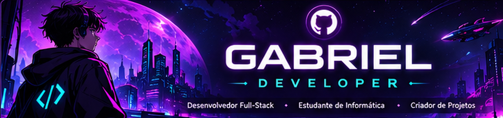
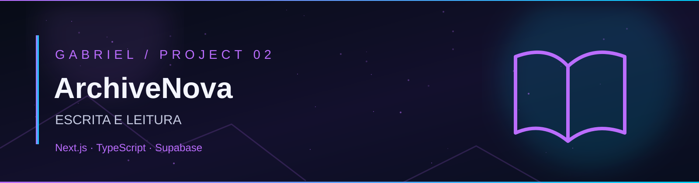
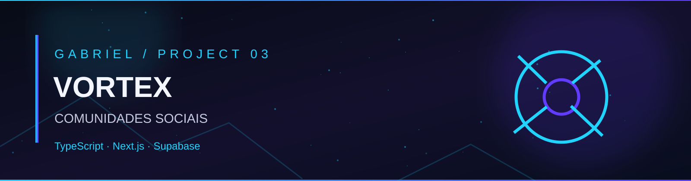
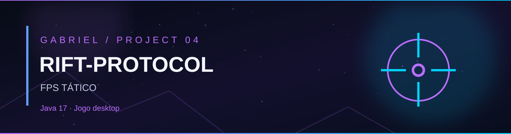
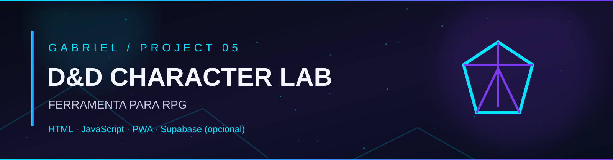
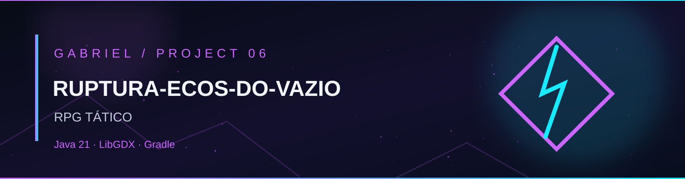

<div align="center">



<br />

<a href="https://github.com/gabriel31249090"></a>
<a href="mailto:gabriel31249090@gmail.com"></a>


<br/><br/>


<br />


</div>

## `> whoami`

Estudante de **Informática** e desenvolvedor em formação. Construo aplicações web, plataformas educacionais, ferramentas de RPG e jogos. Gosto de unir **interfaces marcantes**, funcionalidades reais e aprendizagem constante.

```text
[01] WEB        → Next.js • React • TypeScript
[02] BACKEND    → Supabase • PostgreSQL
[03] GAME DEV   → Java • LibGDX
[04] EXPLORING  → Inteligência artificial • Interfaces • Automação
```

## `> tech_stack`

<div align="center">
  
</div>

## `> featured_projects`

<table>
<tr>
<td width="50%" valign="top">
<a href="https://github.com/gabriel31249090/SIFCAS"></a>
<br/><b>SIFCAS</b> — Plataforma de gestão acadêmica com diário, turmas, frequência, notas, editais e serviços institucionais.<br/><sub>Next.js · React · TypeScript · Supabase</sub><br/><br/>
<a href="https://github.com/gabriel31249090/SIFCAS">📦 Código</a> &nbsp;•&nbsp; <a href="https://sifcas.vercel.app">🌐 Site</a>
</td>
<td width="50%" valign="top">
<a href="https://github.com/gabriel31249090/ArchiveNova"></a>
<br/><b>ArchiveNova</b> — Plataforma para publicação, leitura e gerenciamento de obras e capítulos.<br/><sub>Next.js · TypeScript · Supabase</sub><br/><br/>
<a href="https://github.com/gabriel31249090/ArchiveNova">📦 Código</a> &nbsp;•&nbsp; <a href="https://archivenova.vercel.app">🌐 Site</a>
</td>
</tr>
<tr>
<td width="50%" valign="top">
<a href="https://github.com/gabriel31249090/VORTEX"></a>
<br/><b>VORTEX</b> — Projeto de rede social com comunidades, publicações, comentários e moderação.<br/><sub>TypeScript · Next.js · Supabase</sub><br/><br/>
<a href="https://github.com/gabriel31249090/VORTEX">📦 Código</a> &nbsp;•&nbsp; <a href="https://project-1ktk5.vercel.app">🌐 Site</a>
</td>
<td width="50%" valign="top">
<a href="https://github.com/gabriel31249090/RIFT-PROTOCOL"></a>
<br/><b>RIFT-PROTOCOL</b> — FPS tático em Java com agentes, bots, arenas, habilidades e modo 1v1.<br/><sub>Java 17 · Jogo desktop</sub><br/><br/>
<a href="https://github.com/gabriel31249090/RIFT-PROTOCOL">📦 Código</a>
</td>
</tr>
<tr>
<td width="50%" valign="top">
<a href="https://github.com/gabriel31249090/criador-de-fichas-de-D-D"></a>
<br/><b>criador-de-fichas-de-D-D</b> — Gerenciador de fichas, combate e personagens para D&amp;D 5e, com modo offline.<br/><sub>HTML · JavaScript · PWA · Supabase (opcional)</sub><br/><br/>
<a href="https://github.com/gabriel31249090/criador-de-fichas-de-D-D">📦 Código</a>
</td>
<td width="50%" valign="top">
<a href="https://github.com/gabriel31249090/RUPTURA-ECOS-DO-VAZIO"></a>
<br/><b>RUPTURA-ECOS-DO-VAZIO</b> — RPG isométrico em Java/LibGDX com combate por turnos e escolhas narrativas.<br/><sub>Java 21 · LibGDX · Gradle</sub><br/><br/>
<a href="https://github.com/gabriel31249090/RUPTURA-ECOS-DO-VAZIO">📦 Código</a>
</td>
</tr>
</table>

## `> github_analytics`

<div align="center">


<br />


<br />


</div>

<sub>Os painéis dinâmicos exibem dados públicos e dependem da disponibilidade dos serviços de terceiros. Se algum não carregar, os repositórios e links continuam acessíveis.</sub>

## `> connect`

<div align="center">

**Bora construir alguma coisa?**

<a href="mailto:gabriel31249090@gmail.com"></a>
<a href="https://github.com/gabriel31249090?tab=repositories"></a>

<br/><br/>


**`BUILD // CREATE // EVOLVE`**

</div>
