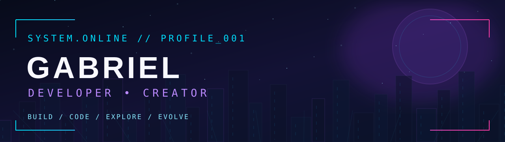

 

 

---

### 01 // SOBRE MIM

Sou **Gabriel**, estudante de Informática e desenvolvedor em formação. Gosto de transformar ideias em **sistemas funcionais**, plataformas e experiências interativas.

- 🎓 Estudante do curso Técnico em Informática.
- ⚙️ Desenvolvimento web, plataformas e automações.
- 🎮 Jogos, Java e experiências interativas.
- ✦ Interesse em inteligência artificial e UI/UX.
- ✉️ **[gabriel31249090@gmail.com](mailto:gabriel31249090@gmail.com)**

### 02 // TECH STACK

### 03 // FEATURED PROJECTS

<table>
<tr><td align="center" width="50%" valign="top"> <strong>Gestão acadêmica</strong> Diário, turmas, notas, frequência e serviços.  <a href="https://github.com/gabriel31249090/SIFCAS">Código</a> · <a href="https://sifcas.vercel.app">Site</a></td><td align="center" width="50%" valign="top"> <strong>Histórias e fanfics</strong> Leitura, publicação, descoberta e editor de textos.  <a href="https://github.com/gabriel31249090/ArchiveNova">Código</a> · <a href="https://archivenova.vercel.app">Site</a></td></tr>
<tr><td align="center" width="50%" valign="top"> <strong>Rede social</strong> Comunidades, posts, comentários e moderação.  <a href="https://github.com/gabriel31249090/VORTEX">Código</a> · <a href="https://project-1ktk5.vercel.app">Site</a></td><td align="center" width="50%" valign="top"> <strong>FPS tático</strong> Jogo em Java com agentes, bots, arenas e 1v1.  <a href="https://github.com/gabriel31249090/RIFT-PROTOCOL">Código</a></td></tr>
<tr><td align="center" width="50%" valign="top"> <strong>Fichas D&D</strong> Personagens, combate e ferramentas de campanha.  <a href="https://github.com/gabriel31249090/criador-de-fichas-de-D-D">Código</a></td><td align="center" width="50%" valign="top"> <strong>RPG tático</strong> Java/LibGDX, exploração e decisões narrativas.  <a href="https://github.com/gabriel31249090/RUPTURA-ECOS-DO-VAZIO">Código</a></td></tr>
</table>

### 04 // GITHUB STATS

 

### 05 // CONTRIBUTIONS

---

**BUILD // CREATE // EVOLVE**

*Transformando ideias em código.*

[GitHub](https://github.com/gabriel31249090) · [Contato](mailto:gabriel31249090@gmail.com)

